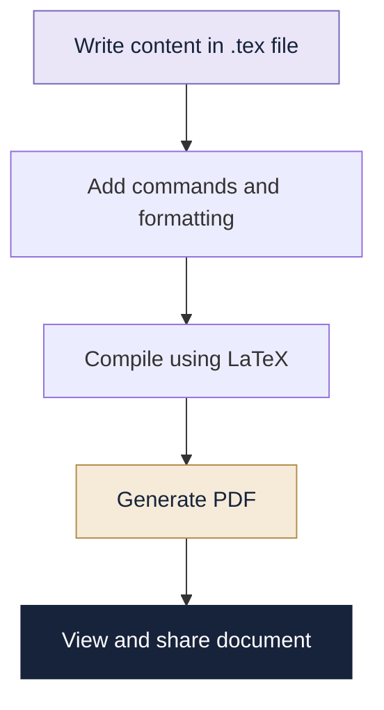

# 01 | LaTeX

> **The art of creating beautifully structured documents.**

---

## 01. First, What Is LaTeX?

LaTeX (pronounced *LAY-tech*) is a document preparation system used to create professional documents with consistent formatting.

Unlike a word processor, where you directly format text, LaTeX uses commands to define the structure and appearance of a document.

**Where is it used?**

- Academic reports and research papers
- Mathematical and scientific documents
- Books, articles and technical manuals
- Assignments and project reports

## 02. How Does It Work?

A LaTeX document is written in a `.tex` file. A compiler processes the source and generates a formatted document, usually a PDF.

```text
Write LaTeX code (.tex)
          |
          v
   LaTeX Compiler
          |
          v
   Formatted PDF
```

## 🗺️ How LaTeX Works



## 03. Anatomy of a LaTeX Document

A basic LaTeX document has two main parts:

- **Preamble:** Document class, packages, title and other settings.
- **Document body:** The actual content of the document.

### Your First LaTeX Document

```latex
\documentclass{article}
\usepackage{amsmath}

\title{My First LaTeX Document}
\author{Student}
\date{\today}

\begin{document}

\maketitle

\section{Introduction}

Welcome to the world of LaTeX!

\section{Mathematics}

\[
E = mc^2
\]

\end{document}
```

## 04. Essential Commands

| Command | Purpose |
|---|---|
| `\documentclass{article}` | Defines document type |
| `\usepackage{...}` | Loads a package |
| `\begin{document}` | Starts document body |
| `\end{document}` | Ends document body |
| `\title{...}` | Defines title |
| `\author{...}` | Defines author |
| `\maketitle` | Displays title |
| `\section{...}` | Creates a section |
| `\subsection{...}` | Creates a subsection |
| `\textbf{...}` | Makes text bold |
| `\textit{...}` | Makes text italic |
| `\underline{...}` | Underlines text |

## 05. Formatting and Lists

**Text formatting**

```latex
\textbf{Bold text}

\textit{Italic text}

\underline{Underlined text}
```

**Bulleted list**

```latex
\begin{itemize}
    \item First point
    \item Second point
    \item Third point
\end{itemize}
```

**Numbered list**

```latex
\begin{enumerate}
    \item First step
    \item Second step
    \item Third step
\end{enumerate}
```

## 06. Mathematical Expressions

Mathematical typesetting is one of LaTeX's strongest features.

| Expression | LaTeX syntax |
|---|---|
| \(a^2\) | `a^2` |
| \(\frac{a}{b}\) | `\frac{a}{b}` |
| \(\sqrt{x}\) | `\sqrt{x}` |
| \(\sum_{i=1}^{n}i\) | `\sum_{i=1}^{n}i` |
| \(\alpha,\beta,\gamma\) | `\alpha,\beta,\gamma` |

**Example: Quadratic formula**

```latex
\[
x = \frac{-b \pm \sqrt{b^2-4ac}}{2a}
\]
```

Inline mathematics uses `$...$`, while displayed mathematics can use `\[...\]`.

## 07. Creating Tables

```latex
\begin{center}
\begin{tabular}{|c|c|}
\hline
Subject & Marks \\
\hline
Mathematics & 90 \\
Physics & 85 \\
Computer Science & 95 \\
\hline
\end{tabular}
\end{center}
```

| Symbol | Meaning |
|---|---|
| `c` | Center alignment |
| `l` | Left alignment |
| `r` | Right alignment |
| `&` | Separates columns |
| `\\` | Ends a row |
| `\hline` | Adds a horizontal line |

## 08. Packages: Extending LaTeX

Packages provide additional functionality.

| Package | Use |
|---|---|
| `amsmath` | Advanced mathematical expressions |
| `graphicx` | Inserting images |
| `geometry` | Adjusting page margins |
| `hyperref` | Adding clickable links |
| `xcolor` | Adding colours |

Example:

```latex
\usepackage{graphicx}
\usepackage[margin=1in]{geometry}
```

## 09. Common Errors

| Error | Likely cause |
|---|---|
| Undefined control sequence | Incorrect command or missing package |
| Missing `$` | Unclosed math mode |
| Missing `\end{...}` | Environment not closed |
| Missing brace | Unmatched `{` or `}` |
| Image not found | Incorrect image path |

## 10. Mini Challenge

Create a one-page student profile containing:

- A title and author name
- An introduction section
- A bulleted list of hobbies
- A table of three subjects and marks
- One mathematical equation

Compile it into a PDF.

## Quick Revision

- `.tex` is the LaTeX source file.
- The preamble defines document settings.
- The document body contains the content.
- Packages extend functionality.
- LaTeX is especially useful for technical and mathematical documents.

---

## 📸 See It in Action

Here is an example of a LaTeX document being written
and compiled into a PDF.


*From source code to a formatted document.*


[← Portfolio Home](../README.md) | [Next: Beamer →](../02-Beamer/README.md)

