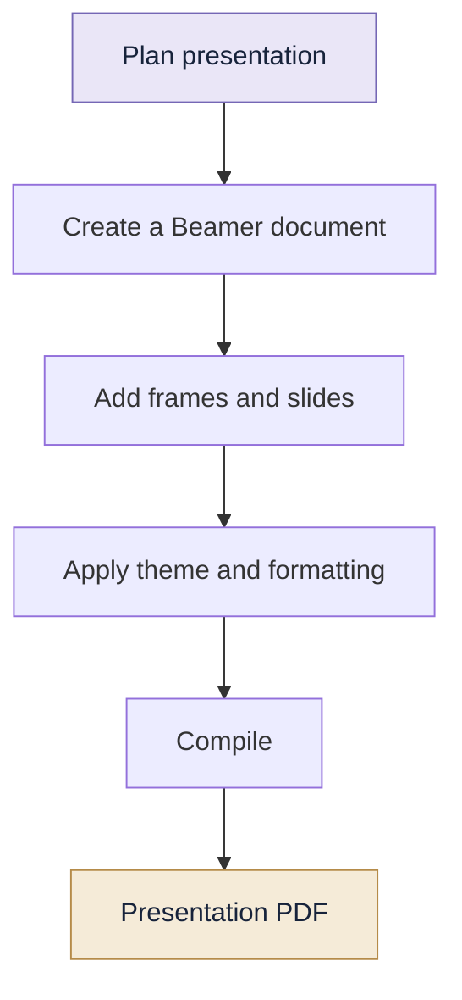
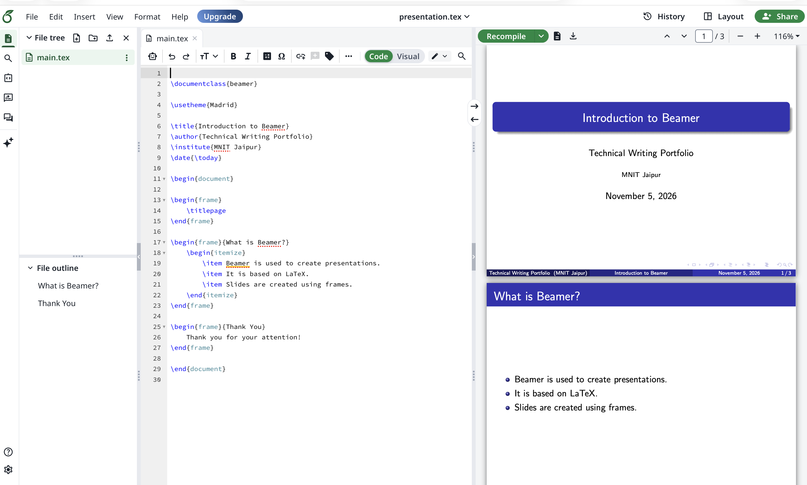

# 02 | Beamer

> **Turn your ideas into structured presentations.**

---

## 01. What Is Beamer?

Beamer is a LaTeX document class used to create presentation slides.

Instead of designing every slide manually, you write structured LaTeX code and compile it into a PDF presentation.


**Why use Beamer?**

- Professional-looking slides
- Mathematical equations and technical content
- Consistent formatting
- Reusable themes and layouts
- Integration with LaTeX documents


## 🎬 How a Beamer Presentation Comes Together



## 02. How Does It Work?

```text
LaTeX Beamer Code
        |
        v
   LaTeX Compiler
        |
        v
  Presentation PDF
```

A Beamer presentation is generally written inside the `frame` environment.

## 03. Your First Presentation

```latex
\documentclass{beamer}

\usetheme{Madrid}

\title{Introduction to Beamer}
\author{Student}
\institute{Technical Writing}
\date{\today}

\begin{document}

\begin{frame}
    \titlepage
\end{frame}

\begin{frame}{Introduction}
    Beamer is used to create presentations
    using LaTeX.
\end{frame}

\end{document}
```

## 04. Understanding the Structure

| Command | Purpose |
|---|---|
| `\documentclass{beamer}` | Selects Beamer |
| `\usetheme{Madrid}` | Applies a presentation theme |
| `\title{...}` | Defines presentation title |
| `\author{...}` | Defines author |
| `\institute{...}` | Defines institution |
| `\date{...}` | Defines date |
| `\begin{frame}` | Starts a slide |
| `\end{frame}` | Ends a slide |
| `\titlepage` | Displays title slide |

## 05. Adding Content to Slides

**Bullet points**

```latex
\begin{frame}{Features of Beamer}

\begin{itemize}
    \item Structured slides
    \item Mathematical equations
    \item Customizable themes
\end{itemize}

\end{frame}
```

**Numbered points**

```latex
\begin{frame}{Steps}

\begin{enumerate}
    \item Write the code.
    \item Compile the file.
    \item View the presentation.
\end{enumerate}

\end{frame}
```

## 06. Themes and Appearance

Beamer provides themes that control the overall appearance.

Some commonly used themes are:

| Theme | Style |
|---|---|
| Madrid | Structured and professional |
| Berlin | Navigation-oriented |
| Copenhagen | Compact and clean |
| CambridgeUS | Formal academic style |
| Warsaw | Distinctive header and footer |

Example:

```latex
\usetheme{Madrid}
```

You can also change colours:

```latex
\usecolortheme{seahorse}
```

## 07. Adding Equations and Images

**Equation**

```latex
\begin{frame}{Mathematics}

\[
E = mc^2
\]

\end{frame}
```

**Image**

```latex
\usepackage{graphicx}

\begin{frame}{An Image}

\includegraphics[width=0.6\textwidth]{image.png}

\end{frame}
```

Keep the image in the same directory as your `.tex` file, or provide its correct relative path.

## 08. Revealing Content Gradually

Beamer supports overlays, which allow content to appear step by step.

```latex
\begin{frame}{Learning Steps}

\begin{itemize}
    \item<1-> Understand the topic
    \item<2-> Study examples
    \item<3-> Practise independently
\end{itemize}

\end{frame}
```

The first item appears first, followed by the second and third.

## 09. Common Errors

| Error | Solution |
|---|---|
| Missing frame environment | Close every `frame` |
| Image not displayed | Check image path |
| Theme not applied | Check `\usetheme` spelling |
| Compilation error | Check braces and environments |
| Text overflowing | Reduce content or font size |

## 10. Mini Challenge

Create a five-slide presentation on a topic of your choice.

Include:

1. A title slide
2. An introduction
3. A bullet-point slide
4. An equation or image
5. A conclusion slide

## Quick Revision

- Beamer is a LaTeX presentation class.
- Every slide is generally created using `frame`.
- Themes control slide appearance.
- Overlays reveal content progressively.
- The compiled output is usually a PDF.

---

## 📸 See It in Action

A sample presentation created using LaTeX Beamer.



*Creating structured presentations with LaTeX Beamer.*


[← LaTeX](../01-LaTeX/README.md) | [Portfolio Home](../README.md) | [Next: Doxygen →](../03-Doxygen/README.md)
