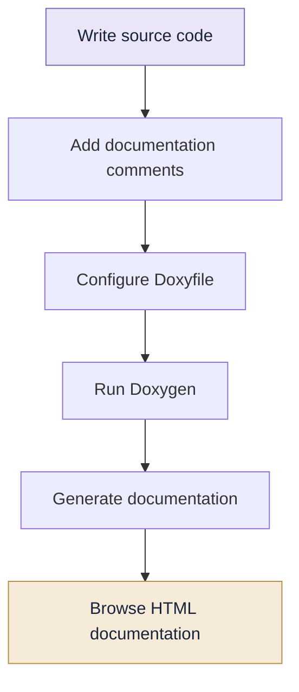
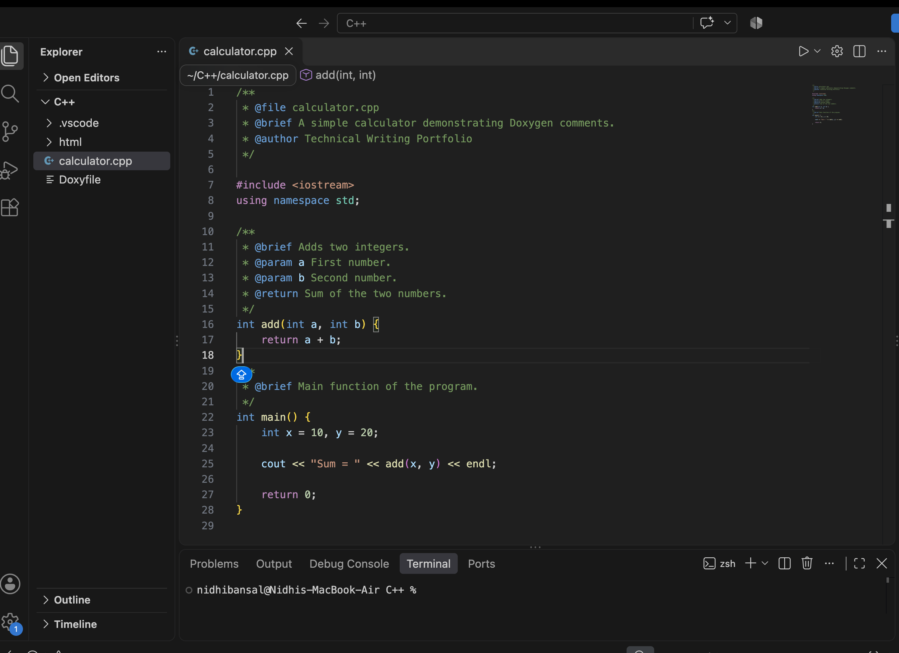
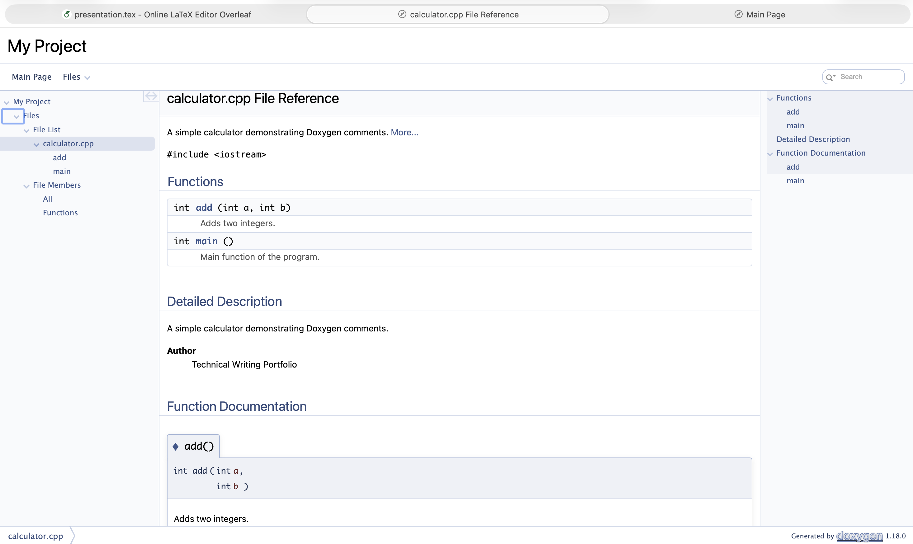

# 03 | Doxygen

> **Let your code explain itself.**

---

## 01. What Is Doxygen?

Doxygen is a documentation generation tool that extracts information from specially formatted comments in source code.

It can generate documentation in formats such as HTML and LaTeX.

**Why is it useful?**

- Explains functions, classes and variables.
- Makes large codebases easier to understand.
- Creates documentation automatically.
- Helps developers maintain and share projects.

## 02. How Does It Work?

```text
Source Code
     |
     v
Special Documentation Comments
     |
     v
   Doxygen
     |
     v
HTML / LaTeX Documentation
```

Doxygen reads documentation comments and connects them with the relevant code elements.


## ⚙️ How Doxygen Works



## 03. Writing Documentation Comments

Doxygen recognises special comment formats.

**C-style documentation comment**

```cpp
/**
 * @brief Adds two integers.
 *
 * @param a First number
 * @param b Second number
 * @return Sum of the two numbers
 */
int add(int a, int b) {
    return a + b;
}
```

**Another supported style**

```cpp
/// @brief Calculates the square of a number.
/// @param n Input number
/// @return Square of n
int square(int n) {
    return n * n;
}
```

## 04. Important Doxygen Commands

| Command | Purpose |
|---|---|
| `@brief` | Short description |
| `@param` | Describes a parameter |
| `@return` | Describes return value |
| `@author` | Specifies author |
| `@date` | Specifies date |
| `@file` | Describes a file |
| `@class` | Documents a class |
| `@details` | Provides detailed description |
| `@see` | Adds a related reference |
| `@note` | Adds a note |
| `@warning` | Adds a warning |

## 05. Documenting a Class

```cpp
/**
 * @brief Represents a student.
 *
 * Stores basic student information.
 */
class Student {
public:

    /**
     * @brief Displays student information.
     */
    void display();
};
```

Documentation can describe classes, member functions, attributes and relationships.

## 06. Generating Documentation

### Step 1: Install Doxygen

On macOS with Homebrew:

```bash
brew install doxygen
```

On Ubuntu:

```bash
sudo apt update
sudo apt install doxygen
```

Verify installation:

```bash
doxygen --version
```

### Step 2: Generate Configuration

Inside your project directory:

```bash
doxygen -g
```

This generates a configuration file named `Doxyfile`.

### Step 3: Configure the Doxyfile

Some useful settings:

| Setting | Purpose |
|---|---|
| `PROJECT_NAME` | Project name |
| `INPUT` | Source files or directories |
| `OUTPUT_DIRECTORY` | Output location |
| `FILE_PATTERNS` | File extensions to process |
| `RECURSIVE` | Search subdirectories |
| `GENERATE_HTML` | Generate HTML output |
| `GENERATE_LATEX` | Generate LaTeX output |

### Step 4: Generate Documentation

```bash
doxygen Doxyfile
```

The output directory will contain the generated documentation.

Open the generated `html/index.html` file in a browser to explore it.

## 07. Practical Example

Create a file named `calculator.cpp`:

```cpp
/**
 * @file calculator.cpp
 * @brief Basic calculator operations.
 */

/**
 * @brief Adds two numbers.
 * @param a First number
 * @param b Second number
 * @return Sum
 */
int add(int a, int b) {
    return a + b;
}

/**
 * @brief Multiplies two numbers.
 * @param a First number
 * @param b Second number
 * @return Product
 */
int multiply(int a, int b) {
    return a * b;
}
```

Run Doxygen after configuring the input file.

## 08. Common Errors

| Problem | Possible solution |
|---|---|
| No documentation generated | Check input paths |
| Comments not recognised | Use valid Doxygen comment syntax |
| Empty HTML output | Check configuration settings |
| Missing source files | Verify `INPUT` and `FILE_PATTERNS` |
| Command not found | Install Doxygen or check PATH |

## 09. Mini Challenge

Create a C++ program containing:

- One class
- Two data members
- A constructor
- Two member functions

Document the class and each function using Doxygen comments. Generate its HTML documentation.

## Quick Revision

- Doxygen generates documentation from source-code comments.
- `@brief` provides a short description.
- `@param` explains function parameters.
- `@return` explains the return value.
- `doxygen -g` creates a configuration file.
- `doxygen Doxyfile` generates the documentation.

---

## 📸 See It in Action

### 1. Writing Documentation Comments



### 2. Generated HTML Documentation



*Turning code comments into structured documentation.*


[← Beamer](../02-Beamer/README.md) | [Portfolio Home](../README.md) | [Next: Google Docs →](../04-Google-Docs/README.md)
