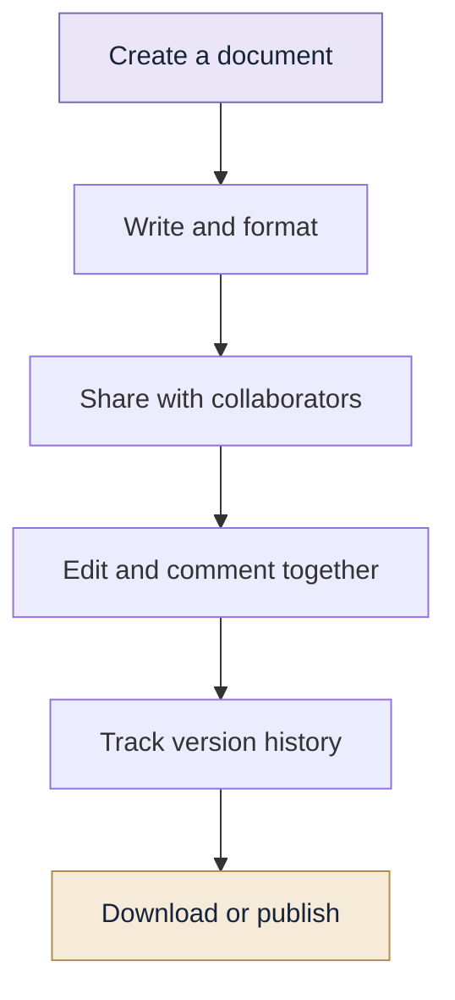
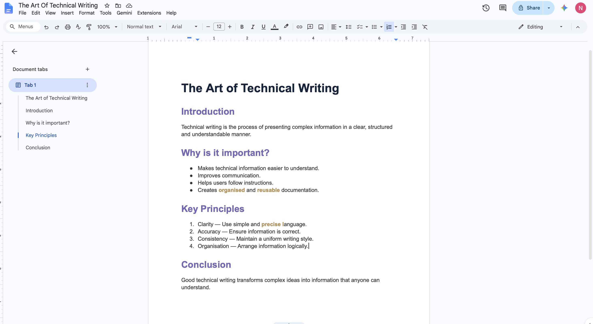
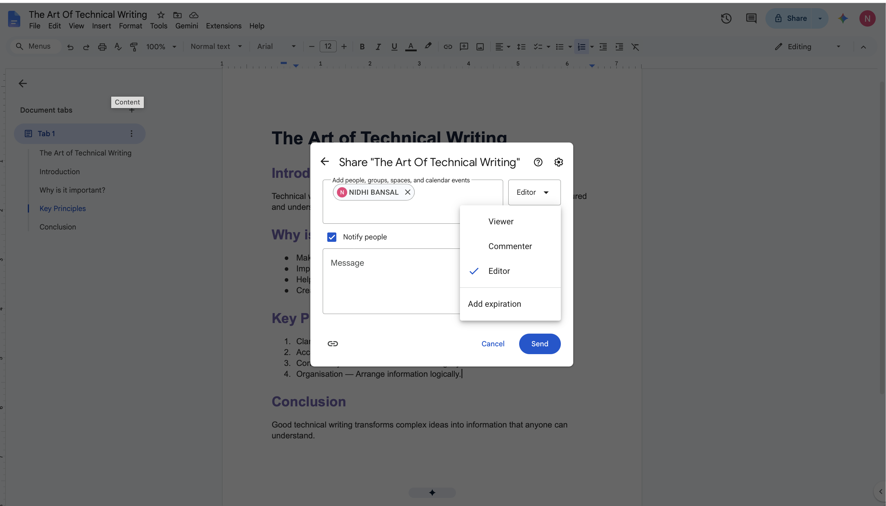
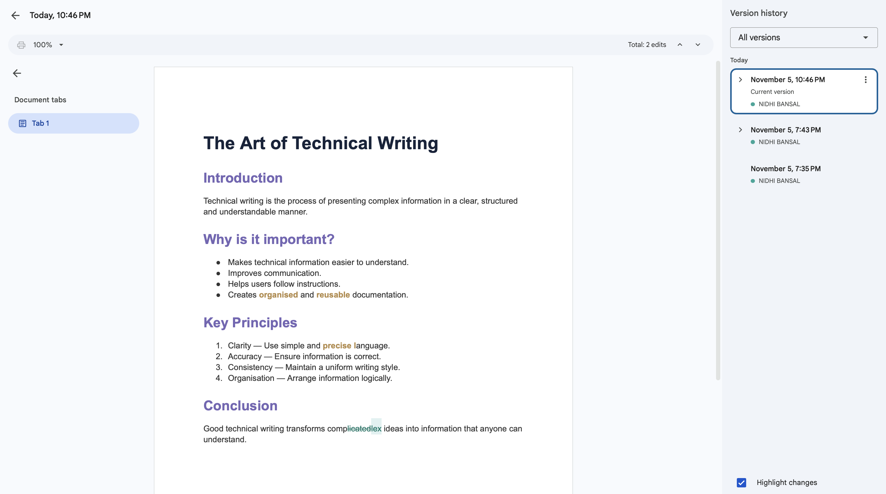

# 04 | Google Docs

> **Create documents. Share ideas. Work together.**

---

## 01. What Is Google Docs?

Google Docs is a web-based word processing application provided by Google.

It allows users to create, edit, format and collaborate on documents online.

**Where is it useful?**

- Assignments and reports
- Meeting notes
- Research documents
- Group projects
- Collaborative writing

## 02. Important Features

| Feature | What it does |
|---|---|
| Editing | Create and modify documents |
| Formatting | Change fonts, sizes, colours and alignment |
| Auto-save | Automatically saves changes |
| Sharing | Gives others access to documents |
| Comments | Allows feedback and suggestions |
| Version history | Shows earlier document versions |
| Voice typing | Converts speech into text |
| Templates | Provides ready-made document layouts |

## 🤝 The Google Docs Workflow

## 03. Creating Your First Document

1. Open [Google Docs](https://docs.google.com/).
2. Sign in using your Google account.
3. Select **Blank document**.
4. Enter a document title.
5. Start writing your content.
6. Use the toolbar to format the document.

## 04. Formatting a Document

Common formatting options:

| Tool | Purpose |
|---|---|
| Bold | Highlights important text |
| Italic | Emphasises text |
| Underline | Underlines text |
| Font size | Changes text size |
| Alignment | Aligns paragraphs |
| Line spacing | Controls space between lines |
| Bullets | Creates unordered lists |
| Numbering | Creates ordered lists |

**Useful keyboard shortcuts**

| Shortcut | Action |
|---|---|
| `Ctrl + B` / `Cmd + B` | Bold |
| `Ctrl + I` / `Cmd + I` | Italic |
| `Ctrl + U` / `Cmd + U` | Underline |
| `Ctrl + Z` / `Cmd + Z` | Undo |
| `Ctrl + K` / `Cmd + K` | Insert link |
| `Ctrl + Shift + 7` | Numbered list |

On macOS, use the `Command` key for the Command-based shortcuts.

## 05. Sharing and Collaboration

Google Docs allows multiple people to work on the same document.

To share a document:

1. Select **Share**.
2. Enter the email addresses of collaborators or adjust general access.
3. Select their permission level.
4. Send the invitation or copy the link.

### Permission Levels

| Permission | Access |
|---|---|
| Viewer | Can view the document |
| Commenter | Can view and comment |
| Editor | Can modify the document |

## 06. Comments and Suggestions

**Comments**

Comments allow collaborators to give feedback without directly changing the document.

**Suggestion mode**

Suggested edits can be reviewed and accepted or rejected by the document owner or an editor.

These features make collaborative editing more organised.

## 07. Version History

Version history allows users to view earlier versions of a document.

To access it:

1. Open the document.
2. Select **File**.
3. Open **Version history**.
4. Select **See version history**.

You can inspect earlier edits and restore an earlier version when appropriate.

## 08. Exporting and Downloading

Google Docs supports multiple file formats.

Go to **File → Download**.

Common formats:

- PDF Document (`.pdf`)
- Microsoft Word (`.docx`)
- Plain Text (`.txt`)
- OpenDocument Format (`.odt`)

PDF is useful when you want to preserve the layout for sharing or submission.

## 09. Common Problems

| Problem | Possible solution |
|---|---|
| Cannot edit | Check your permission |
| Changes not visible | Check internet connection and sync |
| Formatting looks different | Review page and paragraph settings |
| Cannot share | Check account and sharing restrictions |
| Lost an earlier version | Check version history |

## 10. Mini Challenge

Create a two-page report on a topic of your choice.

Include:

- A title and headings
- A formatted paragraph
- A numbered list
- A table
- A hyperlink
- A comment from a collaborator

Download the final report as a PDF.

## Quick Revision

- Google Docs is an online word processor.
- It supports real-time collaboration.
- Viewer, Commenter and Editor are its main access roles.
- Comments and suggestions support feedback.
- Version history helps recover earlier document versions.
- Documents can be downloaded in different formats.

---

## 📸 See It in Action

### 1. Document Formatting

### 2. Sharing and Collaboration

### 3. Version History

*Writing, collaborating and managing documents with Google Docs.*

[← Doxygen](../03-Doxygen/README.md) | [Portfolio Home](../README.md) | [Next: Git →](../05-Git/README.md)
