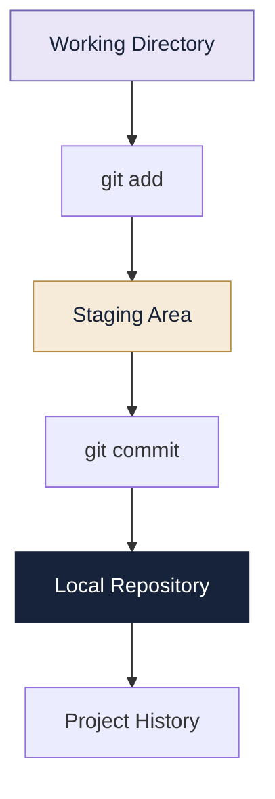

# 05 | Git

> **Every change has a history. Git helps you manage it.**

---

## 01. What Is Version Control?

Version control is a system that records changes to files over time. It allows us to inspect previous versions, compare changes and recover earlier work.

Without version control, projects can end up with files such as:

```text
project.py
project_final.py
project_final_new.py
project_final_latest.py
```

Which one is actually the latest?

Version control solves this problem by maintaining an organised history.

## 02. What Is Git?

Git is a distributed version control system used to track changes in files and manage project development.

**Why use Git?**

- Tracks changes over time.
- Maintains project history.
- Helps recover earlier versions.
- Supports parallel development.
- Makes collaboration easier.

### Git vs GitHub

| Git | GitHub |
|---|---|
| Version control system | Hosting and collaboration platform |
| Works locally | Provides remote repositories |
| Tracks project changes | Helps share and review projects |
| Can work offline | Online features need connectivity |

## 03. Installing Git

**macOS (Homebrew)**

```bash
brew install git
```

**Ubuntu / Debian**

```bash
sudo apt update
sudo apt install git
```

**Windows**

Download Git from:

https://git-scm.com/downloads

Verify installation:

```bash
git --version
```

## 04. Configure Git

Git stores author information with commits.

**Set your name and email globally:**

```bash
git config --global user.name "Your Name"
git config --global user.email "you@example.com"
```

**Set information only for the current repository:**

```bash
git config user.name "Your Name"
git config user.email "you@example.com"
```

**Check configuration:**

```bash
git config --global --list
git config user.name
git config user.email
```

Global settings apply to your repositories unless overridden locally.

## 05. Creating a Repository

A Git repository stores project history and metadata.

```bash
mkdir my-project
cd my-project
git init
```

| Command | Purpose |
|---|---|
| `mkdir` | Creates a directory |
| `cd` | Changes current directory |
| `git init` | Initializes a Git repository |

Git creates a hidden `.git` directory to store repository information.

## 06. Understanding the Git Workflow

Git mainly works with three areas:

```text
 Working Directory
       |
       | git add
       v
  Staging Area
       |
       | git commit
       v
  Local Repository
       |
       | git push
       v
  Remote Repository
       |
       | git pull / fetch
       v
  Local Repository
```

- **Working directory:** Where files are created and edited.
- **Staging area:** Where selected changes are prepared for a commit.
- **Repository:** Where committed history is stored.
- **Remote repository:** A shared repository hosted elsewhere, such as GitHub.


## 🌱 The Git Workflow



## 07. Essential Git Commands

### Check repository status

```bash
git status
```

Shows untracked files, modified files, staged changes and whether the working tree is clean.

### Add files to staging

```bash
git add readme.txt
```

Stage a particular file.

```bash
git add .
```

Stage changes under the current directory.

### Commit changes

```bash
git commit -m "Add initial project files"
```

Records staged changes as a commit.

### View commit history

```bash
git log
```

Displays detailed commit history.

```bash
git log --oneline
```

Displays a compact history.

### Compare changes

```bash
git diff
```

Shows unstaged changes.

```bash
git diff --staged
```

Shows staged changes compared with the last commit.

```bash
git diff HEAD
```

Shows tracked changes compared with the current commit.

### List tracked files

```bash
git ls-files
```

Displays files known to Git's index.

## 08. Understanding git restore

The `git restore` command restores file contents.

**Case A: Discard unstaged changes**

```bash
git restore readme.txt
```

Restores the file to the version in the staging area.

**Case B: Unstage a file but keep its edits**

```bash
git restore --staged readme.txt
```

Removes the file from staging while preserving its working-directory changes.

**Important:** These operations are different.

| Command | Result |
|---|---|
| `git restore file` | Discards unstaged changes |
| `git restore --staged file` | Unstages changes but keeps edits |

Be careful: restoring a file can permanently discard changes that have not been saved elsewhere.

## 09. Renaming and Removing Files

**Rename or move a file**

```bash
git mv old.py new.py
```

Stages the rename operation.

**Remove a tracked file**

```bash
git rm readme.txt
```

Removes the file and stages its deletion.

To record the removal:

```bash
git commit -m "Remove README file"
```

## 10. Ignoring Files

A `.gitignore` file tells Git which untracked files and directories to ignore.

Example `.gitignore`:

```text
__pycache__/
*.pyc
.env
*.log
```

This is useful for excluding temporary files, caches and local configuration.

Remember: adding a file to `.gitignore` does not remove it from history if it has already been committed.

## 11. Reverting a Commit

```bash
git log --oneline
git revert COMMIT_HASH
```

`git revert` creates a new commit that reverses the changes introduced by an earlier commit.

The original commit remains in history.

For example:

```bash
git revert HEAD
```

Reverts the latest commit.

## 12. Checking Out an Earlier Version

```bash
git log --oneline
git checkout COMMIT_HASH
```

This switches the working directory to an earlier snapshot.

It normally places Git in a detached-HEAD state. The current branch does not move.

To return to a branch:

```bash
git checkout main
```

Use your actual branch name if it is different.

### Revert vs Checkout

| Git revert | Git checkout with commit hash |
|---|---|
| Creates a new commit | Does not create an undo commit |
| Preserves existing history | Views an earlier snapshot |
| Reverses selected changes | Changes the working directory to that snapshot |

## 13. Branches

A branch is an independent line of development.

It allows us to work on a feature without directly changing the main branch.

**List branches**

```bash
git branch
```

**Create a branch**

```bash
git branch feature-login
```

**Switch branches**

```bash
git switch feature-login
```

**Create and switch in one command**

```bash
git switch -c feature-login
```

**Rename the current branch**

```bash
git branch -M main
```

## 14. Merging and Rebasing

**Merge**

```bash
git switch main
git merge feature-login
```

Merges changes from `feature-login` into the currently checked-out branch.

**Rebase**

```bash
git switch feature-login
git rebase main
```

Replays feature-branch commits on top of the specified base.

| Merge | Rebase |
|---|---|
| Combines branch histories | Replays commits on a new base |
| May create a merge commit | Rewrites commit identities |
| Preserves existing commits | Can create a linear history |

Avoid rebasing shared commits unless the team understands the consequences.

## 15. Connecting Git to GitHub

A remote connects a local repository to a hosted repository.

**Add a remote**

```bash
git remote add origin REPOSITORY_URL
```

**View remote connections**

```bash
git remote -v
```

**Push commits**

```bash
git push -u origin main
```

The `-u` option sets the upstream tracking relationship.

**Clone a repository**

```bash
git clone REPOSITORY_URL
```

Creates a local copy of a remote repository, including its history.

**Fetch updates**

```bash
git fetch origin
```

Downloads remote updates without integrating them into the current branch.

**Pull updates**

```bash
git pull
```

Fetches and integrates remote changes into the current branch.

## 16. Tags

A tag identifies a particular point in repository history, often used for releases.

**List tags**

```bash
git tag
```

**Create an annotated tag**

```bash
git tag -a v1.0.0 -m "Version 1.0.0"
```

**View tag information**

```bash
git show v1.0.0
```

**Push a tag**

```bash
git push origin v1.0.0
```

## 17. Practical Git Lab: Vector Dot Product

The following workflow follows the Git Basics assignment.

### Step 1: Create a project

```bash
mkdir git-basics-lab
cd git-basics-lab
git init
```

### Step 2: Configure identity

```bash
git config user.name "Your Name"
git config user.email "you@example.com"
```

### Step 3: Create readme.txt

```bash
printf "Vector Dot Product Program\nThis project calculates the dot product of two vectors.\n" > readme.txt
```

Stage the file and check status:

```bash
git add readme.txt
git status
```

### Step 4: Commit the file

```bash
git commit -m "Adding first file."
git status
```

### Step 5: Modify the file

```bash
printf "The program is written in Python.\n" >> readme.txt
git diff
```

### Step 6: Explore restore

Discard unstaged changes:

```bash
git restore readme.txt
```

Stage a new change:

```bash
printf "The program is written in Python.\n" >> readme.txt
git add readme.txt
git status
```

Unstage it while keeping the edit:

```bash
git restore --staged readme.txt
git status
git diff
```

Discard the remaining edit and add a different instruction:

```bash
git restore readme.txt
printf "Run the program using python3 vecadd.py\n" >> readme.txt
git add readme.txt
git commit -m "Update project instructions"
```

### Step 7: View history

```bash
git log
git log --oneline
```

### Step 8: Revert a commit

```bash
git revert HEAD
git log --oneline
git status
```

### Step 9: Add the Python program

Make sure `vecadd.py` exists in the current folder.

```bash
git add vecadd.py
git commit -m "Add vector dot product program"
git log --oneline
```

### Step 10: Remove readme.txt

```bash
git rm readme.txt
git commit -m "Remove README file"
```

### Step 11: Visit an earlier commit

Find a real commit hash:

```bash
git log --oneline
```

Then use:

```bash
git checkout COMMIT_HASH
ls -la
git log --oneline
```

### Step 12: Return to the latest branch

```bash
git checkout main
```

If your branch is named `master`, use:

```bash
git checkout master
```

Check the final status:

```bash
git status
```

**Note:** Replace example names, emails, repository URLs and commit hashes with your actual values. Do not run a placeholder hash literally.

## 18. Common Git Errors

| Problem | What to check |
|---|---|
| Untracked files | Use `git add` |
| Nothing to commit | Inspect `git status` |
| Push rejected | Fetch and integrate remote changes |
| Merge conflict | Resolve conflicting files |
| Wrong branch | Check `git branch` |
| Authentication failed | Check credentials and permissions |

## 19. Git Best Practices

1. Commit changes frequently and logically.
2. Write meaningful commit messages.
3. Use descriptive branch names.
4. Review changes before committing.
5. Fetch or pull remote updates regularly.
6. Test changes before merging.
7. Never commit passwords or API keys.
8. Maintain a useful README file.

## 20. Quick Command Reference

| Command | Purpose |
|---|---|
| `git --version` | Check Git version |
| `git init` | Initialize repository |
| `git config` | Configure Git |
| `git status` | Check status |
| `git add` | Stage changes |
| `git commit` | Record changes |
| `git log` | View history |
| `git diff` | Compare changes |
| `git restore` | Restore file contents |
| `git revert` | Reverse a commit |
| `git checkout` | Switch branch or snapshot |
| `git branch` | Manage branches |
| `git switch` | Switch branches |
| `git merge` | Merge branches |
| `git rebase` | Replay commits |
| `git clone` | Copy remote repository |
| `git remote` | Manage remotes |
| `git push` | Upload commits |
| `git pull` | Fetch and integrate |
| `git fetch` | Download remote updates |
| `git rm` | Remove tracked file |
| `git mv` | Move or rename tracked file |
| `git ls-files` | List tracked files |
| `git tag` | Manage tags |

---

[← Google Docs](../04-Google-Docs/README.md) | [Portfolio Home](../README.md) | [Next: GitHub →](../06-GitHub/README.md)
