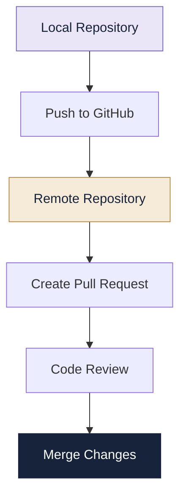

# 06 | GitHub

> **Your code deserves a place where it can grow.**

---

## 01. What Is GitHub?

GitHub is an online platform used to host Git repositories and collaborate on software projects.

It allows developers to share code, maintain project history, review contributions and work together.

**What can you do with GitHub?**

- Store projects online.
- Share source code.
- Collaborate with other developers.
- Review code through pull requests.
- Track tasks and bugs using Issues.
- Maintain project documentation.


## 02. Understanding a Repository

A repository (repo) is a place where a project's files and version history are stored.

A typical repository may contain:

```text
calculator/
│
├── README.md
├── main.py
├── requirements.txt
├── .gitignore
└── docs/
```

The README introduces the project, while `.gitignore` specifies files that Git should ignore.


## 🚀 From Local Code to Collaboration



## 03. Creating a GitHub Repository

1. Visit [GitHub](https://github.com/).
2. Sign in to your account.
3. Select **New repository**.
4. Enter a repository name.
5. Choose Public or Private visibility.
6. Optionally add a README and `.gitignore`.
7. Select **Create repository**.

### Public vs Private

| Public repository | Private repository |
|---|---|
| Anyone can view it | Access is restricted |
| Useful for open-source projects | Useful for restricted projects |
| Can be shared publicly | Shared with authorised users |

## 04. Connecting a Local Repository

A local repository can be connected to GitHub using a remote.

```bash
git remote add origin REPOSITORY_URL
```

Check the remote:

```bash
git remote -v
```

Rename the current branch:

```bash
git branch -M main
```

Push the code:

```bash
git push -u origin main
```

After successful authentication, your local commits become available in the GitHub repository.

## 05. Cloning a Repository

Cloning creates a local copy of a remote repository, including its Git history.

```bash
git clone REPOSITORY_URL
```

Cloning typically:

- Downloads repository files and history.
- Creates a local Git repository.
- Configures the original repository as `origin`.
- Sets up references to remote branches.

## 06. Pushing, Pulling and Fetching

These commands help synchronise local and remote repositories.

| Command | Purpose |
|---|---|
| `git push` | Upload local commits |
| `git pull` | Fetch and integrate remote changes |
| `git fetch` | Download remote updates without integrating |
| `git remote -v` | View configured remotes |

**Remember:** `git fetch` lets you inspect updates first, while `git pull` also attempts to integrate them.

## 07. Branches on GitHub

Branches allow developers to work on different features independently.

Example:

```text
main
 |
 |---- feature-login
 |
 |---- feature-search
 |
 |---- fix-navbar
```

A typical workflow:

```bash
git switch -c feature-login
```

Make your changes, then:

```bash
git add .
git commit -m "Add login feature"
git push -u origin feature-login
```

The new branch will now be available on GitHub.

## 08. Pull Requests

A Pull Request (PR) is a proposal to merge changes from one branch into another.

### Typical PR Workflow

1. Create a feature branch.
2. Make and commit changes.
3. Push the branch to GitHub.
4. Open the repository on GitHub.
5. Select **Compare & pull request**.
6. Describe your changes.
7. Request a review.
8. Merge after review and approval.

A pull request supports discussion, review and collaboration before changes are integrated.

**Important:** A Pull Request is not the same as the Git command `git pull`.

## 09. Forking a Repository

A fork is a separate hosted copy of another user's repository under your GitHub account.

It is commonly used when contributing to projects you do not own.

### Fork vs Clone

| Fork | Clone |
|---|---|
| Creates a hosted copy | Creates a local copy |
| Happens on GitHub | Happens on your computer |
| Supports independent contributions | Supports local development |

A common contribution workflow is:

```text
Original Repository
        |
        v
       Fork
        |
        v
      Clone
        |
        v
 Make Changes and Commit
        |
        v
      Push
        |
        v
   Pull Request
```

## 10. GitHub Issues and Projects

### Issues

Issues help teams report and discuss:

- Bugs
- Feature requests
- Questions
- Tasks and improvements

Example:

**Issue:** Calculator crashes when dividing by zero.

**Description:** Add input validation and display an appropriate error message.

### Projects

GitHub Projects helps organise work and track progress.

Example task board:

| Status | Task |
|---|---|
| Todo | Design interface |
| In Progress | Implement calculator |
| In Review | Test input validation |
| Done | Write README |

## 11. Code Review and Collaboration

Code review is the process of examining changes before they are merged into a shared branch.

A reviewer may:

- Check correctness.
- Identify bugs.
- Suggest improvements.
- Review readability.
- Verify tests.

A contributor should respond to feedback and update their branch when necessary.

## 12. GitHub Tags and Releases

Tags identify important commits, often used to mark software versions.

Create a tag locally:

```bash
git tag -a v1.0.0 -m "Version 1.0.0"
```

Push it:

```bash
git push origin v1.0.0
```

GitHub Releases can use tags to publish release notes and downloadable files.

## 13. Security and Best Practices

- Never share passwords or personal access tokens.
- Do not upload private SSH keys.
- Use `.gitignore` for sensitive local configuration files.
- Enable two-factor authentication.
- Check repository visibility before publishing.
- Review permissions before adding collaborators.
- Keep commit messages meaningful.
- Use pull requests to review important changes.

## 14. Mini Challenge

Create a GitHub repository for a simple project.

Complete the following:

1. Create a local Git repository.
2. Add a README file.
3. Commit your files.
4. Create an empty GitHub repository.
5. Connect your local repository to GitHub.
6. Push the project.
7. Create a feature branch.
8. Make a small change and push it.
9. Open a Pull Request.
10. Review and merge the changes.

## Quick Revision

- GitHub hosts Git repositories online.
- A repository stores project files and history.
- Cloning creates a local copy.
- Forking creates a separate hosted copy.
- Branches support independent development.
- Pull Requests support code review and merging.
- Issues and Projects help manage work.

---

[← Git](../05-Git/README.md) | [Portfolio Home](../README.md)
