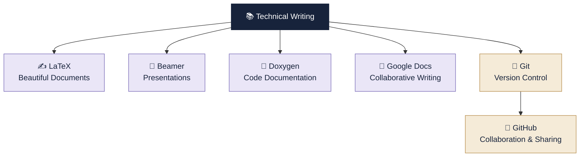

# TW Documentation Portfolio

**A collection of practical documentation and tools explored in Technical Writing.**

---

## Welcome

Technical writing is more than writing documents. It is about presenting information clearly, organising knowledge, documenting work, and communicating ideas effectively.

This portfolio brings together the concepts and tools explored during the Technical Writing course, along with examples, practical demonstrations, and useful references.

## 🧭 Your Learning Journey

Six tools. Six different skills. One documentation journey.

## Explore the Portfolio

| No. | Topic | What You Will Explore |
|:---:|---|---|
| 01 | [LaTeX](01-LaTeX/README.md) | Create structured and professionally formatted documents. |
| 02 | [Beamer](02-Beamer/README.md) | Design presentations using LaTeX. |
| 03 | [Doxygen](03-Doxygen/README.md) | Generate documentation directly from source code. |
| 04 | [Google Docs](04-Google-Docs/README.md) | Create, edit, format, and collaborate on documents. |
| 05 | [Git](05-Git/README.md) | Understand version control and practise Git commands. |
| 06 | [GitHub](06-GitHub/README.md) | Host projects, manage repositories, and collaborate. |

---

## What This Portfolio Contains

- **Concepts:** Understand the purpose and fundamentals of each tool.
- **Examples:** Learn through practical demonstrations.
- **Commands & Syntax:** Explore useful commands and their applications.
- **Troubleshooting:** Identify common errors and their solutions.
- **Quick References:** Revise important concepts efficiently.

## How to Explore

You can explore the topics independently or follow the numbered sequence.

Each topic has its own documentation page, organised to make learning and revision easier.

---

**TECHNICAL WRITING PORTFOLIO**

*Documentation • Practical Learning • Digital Tools*

